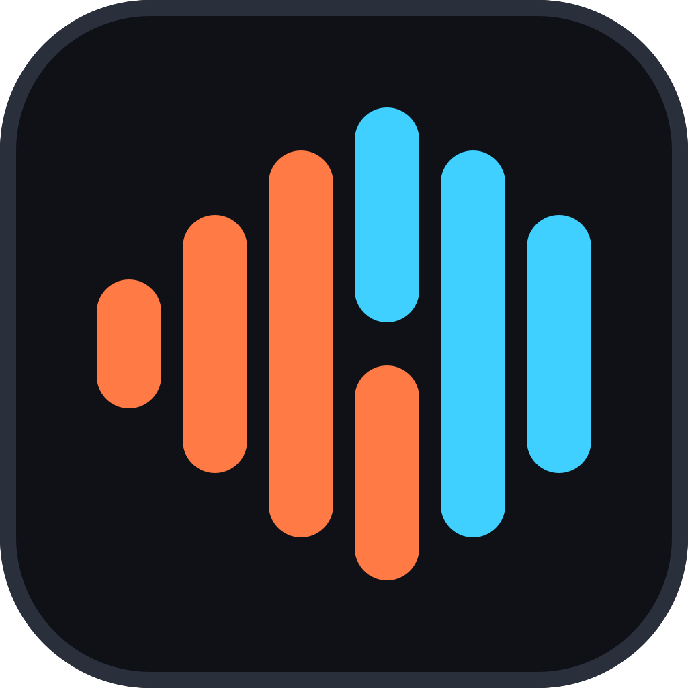

  

<h1 align="center">MicNook</h1>

  親愛的，我把在家唱K變簡單了。 
  Windows 電腦版 AI 卡拉 OK：貼上 YouTube 網址，就能唱。

  <a href="https://github.com/Gargion/micnook-releases/releases/latest"><b>⬇ 下載最新版</b></a>
  &nbsp;·&nbsp;
  <a href="https://micnook.com">官網</a>
  &nbsp;·&nbsp;
  <a href="#english">English</a>

---

## 下載哪一個檔案？

打開[最新版](https://github.com/Gargion/micnook-releases/releases/latest)，在 **Assets** 下載：

| 檔案 | 給誰 |
|---|---|
| **`MicNook_<版本>_Setup.exe`** | ✅ **第一次安裝請下載這個**（約 7 MB，有安裝畫面） |
| `MicNook_<版本>_update.exe`（0.1.3 以前叫 `_x64-setup.exe`） | App 自動更新用的，一般不用下載 |
| `runtime-*` 標籤裡的檔案 | AI 元件，App 第一次開啟時會自己下載，**不用手動下載** |

已經裝好的電腦會自動更新，不必再回來這裡。

## 安裝

1. 執行 `MicNook_<版本>_Setup.exe`，按「安裝」。裝在你自己的帳號下，不需要系統管理員權限。
2. 第一次開啟時，App 會自動下載 AI 元件（約 940 MB，只下載一次；斷線會從斷點接著下載）。下載期間可以先逛逛，匯入新歌要等元件齊全。
3. 接上麥克風，貼上 YouTube 網址，開唱。

## 可以做什麼

- **貼網址就能唱**：自動分離人聲做出伴奏，找歌詞並對準到每一個字
- **即時音準評分**：唱的時候看得到自己的音高線，唱完有分數與演唱分析
- **練歌模式**：A／B 區間循環、變速不變調、升降 Key
- **點歌佇列**：一首接一首，多位演唱者輪流唱，各自記住成績與 Key
- **大家在唱**：熱門歌曲榜、每首歌的高分榜、看看好友最近唱什麼（需登入）
- **五種介面語言**：繁體中文、简体中文、English、日本語、한국어

歌曲、伴奏、錄音與歌詞都只存在你的電腦，不會上傳。

## 系統需求

| 項目 | 需求 |
|---|---|
| 作業系統 | Windows 10／11（64 位元） |
| 麥克風 | USB 麥克風或電腦內建麥克風都可以 |
| 硬碟空間 | AI 元件約 1 GB，另加歌曲庫（每首歌的影片與音軌） |
| 顯示卡 | 不一定要。有 NVIDIA 顯示卡時處理一首歌最快；沒有也能用，只是比較慢 |
| 網路 | 第一次下載 AI 元件與匯入歌曲時需要 |

Mac 版開發中。

## 常見問題

**Windows 跳出「Windows 已保護您的電腦」？**
點「其他資訊」→「仍要執行」。

**AI 元件下載失敗或卡住？**
在歌曲庫上方的「準備 AI 元件」按「重試」；暫停後也可以按「繼續」從斷點接著下載。

**遇到問題要回報？**
App 右下角帳號按鈕 →「我的帳號」→「這台電腦」→「回報問題」，不用登入也能送。

---

## English

**MicNook** is an AI karaoke app for Windows. Paste a YouTube link — it separates the vocals, syncs the lyrics word by word, and scores your pitch in real time.

**Download:** open the [latest release](https://github.com/Gargion/micnook-releases/releases/latest) and get **`MicNook_<version>_Setup.exe`**. The `_update.exe` file (`_x64-setup.exe` up to 0.1.3) is used by auto-update, and the `runtime-*` files are AI components the app downloads by itself on first launch (about 940 MB, once).

**Requirements:** Windows 10/11 (64-bit) and a microphone. An NVIDIA GPU makes song processing fastest but is not required.

Songs, recordings, and lyrics stay on your computer.
